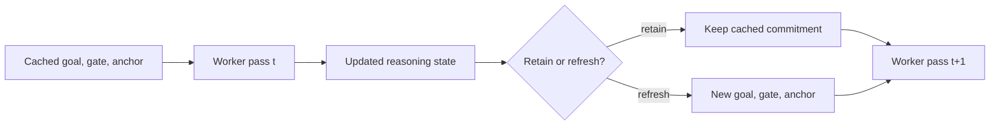

# When Revision Has No Successful Alternative: Auditing Persistent Subgoals in Hierarchical Reasoning

Ayushi Chadha

Working manuscript, November 16, 2026. Diagnostic framing based on completed
local evidence. Related-work verification, venue formatting, and final submission
metadata remain pending. This title does not assert an improvement result.

Editorial status, November 17: this file preserves the completed HRM diagnostic
evidence. The active research program now extends paper 2's adaptive-controller
question to verified mathematical search; see [the consolidated plan](README.md).
The present abstract and results do not describe a completed mathematical-search
controller study. A future manuscript will be organized around that study only
after its controlled experiments establish what can be claimed.

## Abstract

Persistent latent subgoals offer a mechanism for coordinating computation across
multiple reasoning steps, but deciding when to replace them requires evidence
that revision improves downstream outcomes. We audit this question in Scout,
an extension of the Hierarchical Reasoning Model with manager-generated
directional goals and worker alignment. In an archived 64-episode diagnostic,
persistence is preferred by the recorded loss comparison in 347 of 384 decision
states. Yet neither persistence nor a forced revision produces an exact solve.
A broader development audit covering 80 source problems likewise records no
exact solves under either intervention. A repeated-batch competence control
reaches 96.72% token accuracy after 1,600 updates while solving none of four
examples. An offline match to the preprocessed inputs shows that all four
predictions copy the input on every scored token, matching the identity baseline
and getting none of the 13 transformation-required tokens correct. These observations limit the interpretation of score-based revision
preferences: they do not establish successful subgoal selection or improved
problem solving. We distinguish the HRM mechanism from partial latent-goal and
explicit search-controller explorations, and specify an evaluation sequence
based on worker competence, causal goal utility, terminal revision opportunity,
and frozen-policy comparisons. The current evidence motivates these checks;
it does not demonstrate an advantage for adaptive HRM revision.

## 1. Introduction

Hierarchical reasoning separates slower coordination from faster computation.
A manager can communicate a persistent goal to a worker rather than choose each
worker action directly. Persistence creates a further decision: should the
current goal remain active, or should the manager replace it using the new
reasoning state? Updating too frequently may interrupt useful computation;
retaining an unsuitable goal may waste the remaining budget.

Scout investigates this decision within HRM. The scientific question is whether
state-dependent revision of persistent feudal subgoals can improve final task
outcomes beyond time-based schedules and observable reactive rules. A convincing
test requires more than a predictor that distinguishes the losses of two
branches. The worker must solve tasks, its behavior must depend on the goals,
and the available revisions must sometimes improve terminal success.

This report examines whether the available evidence satisfies those conditions.
Its contribution is a scoped empirical diagnosis and an explicit evaluation
protocol. It does not introduce an established superior revision policy. The
observations concern the audited checkpoints and data regime, and do not imply
that HRM or hierarchical reasoning is generally unable to solve these tasks.

## 2. Persistent directional goals inside HRM

HRM maintains high- and low-level recurrent hidden states. Scout projects the
manager's high-level state into a directional goal, optionally with a scalar
gate. The recurrent carry caches the goal, gate, and worker anchor until the
next update. The worker consumes that cached commitment during refinement.

In the corrected causal interface, a manager emission after outer pass t first
influences pass t+1. The manager period counts outer ACT refinement calls rather
than inner transformer cycles. Under the eight-pass evaluation budget, the
first pass is initially unsteered and an emission after the terminal pass cannot
affect the scored outcome. Goal resets are per sample.

The directional configuration aligns worker displacement from the commitment
anchor with the cached goal. Schematically, for worker representation w, anchor
b, and goal g, the auxiliary term is 1 − cos(w − b, g), combined with the task
and halting objectives using the configured weight. This describes the
directional configuration; the code also preserves a historical absolute-state
alignment mode. Stored recurrent commitments are detached between calls. The
adaptive implementation provides local manager/trigger credit through a
value-preserving reconstruction on the consuming pass, rather than full
backpropagation through the entire episode.

The implementation lives in `HRM/models/subgoal_head.py`,
`HRM/models/hrm/hrm_act_v1.py`, and `HRM/models/losses.py`. Mechanism tests
check properties such as timing and gradients. Passing those tests establishes
implementation behavior under the tested conditions, not empirical goal utility.

The causal decision boundary is:

## 3. What revision value should measure

For a frozen worker, define the terminal revision advantage at state s and pass
t as the expected success after refreshing the goal minus expected success
after retaining it, conditional on the same remaining budget and subsequent
policy. Both branches must begin from the same complete state. If the worker
or environment is stochastic, branch randomization and repeated continuations
must be specified.

This quantity differs from a local loss difference. A small improvement in token
loss can leave the exact predicted solution unchanged. It can also improve many
already-correct tokens while retaining the few errors that determine failure.
Consequently, loss preference is a secondary diagnostic rather than a substitute
for terminal success.

A selective policy also needs more than hindsight headroom. Its observable
features must identify beneficial actions before their outcomes are available.
Evaluation must therefore distinguish branch opportunity, supervised prediction
on held-out states, and whole-trajectory performance of a frozen policy. Repeated
states from the same problem belong to the same partition and uncertainty unit.

## 4. Audit methods

We inspect saved artifacts rather than rerun checkpoint inference. The original
endpoint table contains 64 episodes and six eligible revision positions per
episode, producing 384 branch rows. The development table contains 80 episodes
from 80 recorded sources and the same six positions, producing 480 rows.
Persistence outcomes repeat across decision positions and must not be counted
as independent successful trials. Both tables score exact completion after the
fixed eight-pass trajectory.

The archived score diagnostic contains 384 state-level preferences. We count
its PERSIST labels separately from the endpoint audit. To inspect fitting
capacity, we also examine saved decoded predictions and configuration from a
1,600-update repeated-batch run. All four examples share one puzzle identifier.
This control concerns fitting on that batch, not source-level generalization.

The accompanying audit script recomputes counts and records SHA-256 identities
for the input artifacts. It neither authenticates the original execution nor
reconstructs absent checkpoints. The audit output makes this boundary explicit. The current repository test suite passes 96 tests; those
checks do not constitute a fresh experimental replication.

## 5. Findings

| Audit | Evaluation units | Observed outcome |
|---|---|---|
| Score preference | 384 states / 64 episodes | PERSIST preferred in 347 states (90.4%) |
| Original endpoint comparison | 64 episodes / 384 revision branches | Zero persistence solves; zero revision solves |
| Development endpoint comparison | 80 sources / 480 revision branches | Zero persistence solves; zero revision solves |
| Repeated-batch control | Four examples / one puzzle ID | 13 errors among 396 scored tokens; zero exact solves |

The endpoint comparisons contain no successful rescues and no successful
solutions lost by revision. They therefore cannot establish whether a policy
chooses between successful and unsuccessful alternatives. They still permit
analysis of score changes, provided those changes are described as such.

The repeated-batch control yields 96.72% token accuracy, exactly matching input
copying. The four archived targets uniquely match preprocessed training rows
40055, 40056, 40057, and 40053, in saved prediction order. All 396 scored
predictions equal their corresponding input tokens. Of these tokens, 13 require
a change to match the target; the model gets zero of those 13 correct. Within
this puzzle identifier, the matched examples have no identical-input/conflicting-
target duplicates. This check does not establish dataset-wide consistency. Its remaining errors
illustrate why this number cannot be read as task-solving competence. The
saved predictions establish failure on these four examples; they do not identify
the cause. Independent comparison of the decoded grids confirms error counts
of 4, 2, 2, and 5. The color confusions are 6→4 (four tokens), 4→8 (two),
9→1 (two), and 8→2 (five); no scored boundary symbol is mistaken. This narrows
the observed failure pattern without identifying a training defect. Data
handling, representation, training dynamics, and alignment
interference remain candidate explanations requiring controlled checks.

Taken together, these results put competence ahead of further revision-policy
optimization in the current regime. They do not justify another increase in
training budget without investigating the observed plateau, nor do they prove
that useful revision is impossible with a competent worker.

## 6. Supporting explorations and mechanism boundaries

Three experimental families share an abstract retain/revise question while
implementing different mechanisms. They should be interpreted separately.

The explicit SQLite controller chooses when to switch between services under a
call budget and synthetic failures. Its frozen comparisons report state-aware
completion improvements of 1.90–3.63 percentage points over learned timing.
Advantages over reactive rules are inconsistent, and persistent-outage cases
show harms. These results concern explicit service commitments rather than
HRM latent goals. The numerical statements here are taken from the preserved
explicit protocol; the present evidence script does not recompute them.

The SQLite latent bridge conditions a small learned worker on cached Scout
goals and permits refresh. It is a partial mechanism transfer: it does not
instantiate full HRM recurrence and omits the original directional auxiliary
loss. Across three runs totaling 1,500 workflows, state-aware refresh rescues zero
and loses one workflow relative to learned timing. This does not demonstrate
added value from state over learned timing. It cannot supply the missing HRM competence evidence.

The circle-packing branch chooses between local and broad numerical search.
Its completed neural study uses 80 fitting, 20 validation, and 40 test
trajectories. On test, neural supervision minus checkpoint-only selection is
+0.001146 in final radius sum, with a trajectory-bootstrap interval of
[−0.000263, +0.002800]. Against always-local search the difference is −0.000333,
with interval [−0.001957, +0.001253]. Neither comparison establishes neural
superiority. Three checkpoint decisions within each trajectory are grouped for
uncertainty. This experiment, including its external-model supervisor variant,
does not implement HRM's recurrent hierarchy, directional goals, or feudal loss.

These explorations inform evaluation design. They do not establish a chain
from HRM subgoals to a successful general meta-agent.

Mathematical search was selected to move toward substantive, independently
verifiable research tasks. An autonomous research system must additionally choose
experiments sequentially, retain evidence from failures, verify proposed results,
and preserve an auditable decision history. The existing single-decision study
establishes neither such a complete research loop nor a mathematical record.
For trustworthy evolution, the relevant proposed safeguards are independent
verification, explicit resource accounting, regression checks against the incumbent,
and rejection of unsupported improvements. Their effectiveness remains to be tested.

### Benchmark audit and feasibility contract

The mathematical objective is the sum of independently sized radii in a unit
square. Equal-radius packing tables solve a different optimization problem and
are not eligible reference bounds. Our archived reference construction has
radius sum 2.6359830849176076. This is an artifact-specific numerical comparison,
not a claim that this value is the current global record.

An Exa-assisted source audit retrieved the original OpenEvolve report [9], which
reports 2.6359773947566274, and Friedman's sum-of-radii table [10], which lists
2.63598+ for 26 circles. The rounded table entry cannot resolve differences in
later decimal places. A subsequent author report [11] distinguishes zero-tolerance
finite-decimal witnesses from constructions valid only with relaxed geometric
constraints. It explicitly limits its ranking to a manifested corpus and does
not claim global optimality. We have read that report but have not independently
replayed its certificates; its precise score is therefore not an independently
verified target in this study.

Our floating-point checker and conservative radius repair provide numerical
checks, not an exact rational certificate. A record claim would require preserving
the serialized coordinates, pinning the comparator artifact, and checking all
wall and squared pair-distance inequalities under the same feasibility contract.
Unrepaired and repaired scores must be reported separately. Optimizer improvement,
controller improvement, and a new mathematical bound are separate claims with
separate evidence requirements.

## 7. Controlled evaluation: implementation and remaining evidence

### 7.1 Implemented mathematical-search opportunity protocol

The active extension of the adaptive-controller study uses an explicit persistent
search recipe rather than an HRM latent goal. KEEP retains the current recipe;
REVISE replaces the initial local perturbation scale (0.015) with a broad scale
(0.12), which persists for the rest of the episode. Both recipes perturb the
best verified construction and invoke the same SLSQP worker. This restricted
one-way replacement isolates timing; it does not implement arbitrary strategy
generation, learned subgoals, or a trained revision policy.

The prepared development protocol uses 26 circles, eight windows, 80 objective
evaluations per window, and at most 40 SLSQP iterations per call. When a call
terminates early, another call consumes the remaining window allowance. Every
complete trajectory therefore consumes exactly 640 objective evaluations.
Initialization uses a common repaired random geometry without optimization.
The initial commitment is active in window 0. Each matched schedule replaces it
once, before one of windows 1 through 7. All seven schedules have two emissions;
never-revise is a separately labeled one-emission baseline. Revision affects
only future computation.

A never-revise rollout provides prefix checkpoints. Each schedule clones its
incumbent, score, commitment, window, and evaluation counters. Random draws are
keyed by seed, window, and within-window call index. Thus corresponding indices
share standardized draws without outcome-dependent random-stream selection.
Every SLSQP call starts afresh; no optimizer history crosses window boundaries.
Calls may terminate at different points, so shared streams do not imply identical
optimizer paths. This is a frozen worker contract, not a claim to clone an opaque
in-flight optimizer.

The worker retains the highest-scoring feasible incumbent. Independent
floating-point geometry checks validate returned constructions. The dispatcher
replays geometry, score, timing, and accounting checks before accepting serialized
results. Window runtime includes repair and verification. Equal objective counts
do not imply equal constraints, derivatives, FLOPs, or wall time. Shared-prefix
collection executes 2,880 objective evaluations per seed; shared work remains
included in every policy's logical episode budget rather than becoming free
policy compute. Floating-point feasibility is not a rigorous record certificate.

The development report compares the best mean fixed timing with a retrospective
per-seed timing oracle and the never-revise baseline. Oracle advantage uses
terminal outcomes and is an optimistic opportunity diagnostic, not deployable
policy performance. Twelve development seeds are prepared; no confirmation
seeds are used by this collector. Before fitting a controller, split by whole
initial trajectory, fix a practical effect threshold and sample-size plan, and
compare state-aware models with time-only and reactive controls. An oracle gap
alone does not establish predictable opportunity.

Implementation resides in `scripts/matched_revision.py` and
`scripts/modal_matched_revision.py`. Sequential CPU calls have source-identity
checks, timeouts, no automatic retries, and fail-closed pending-call markers.
Local validation passed 111 repository tests, including nine new protocol tests
and a tiny three-circle integration test. At implementation validation, no 26-circle timing experiment had run. The
subsequent development audit is reported below; learned-controller superiority
and record improvements remain unestablished.

### Completed development timing audit (November 17, 2026)

All twelve prepared seeds completed on Modal CPU without adding a payment method.
All 96 trajectory constructions and traces passed local geometry and accounting
revalidation. The highest mean fixed-timing score was 2.619759325, from replacement
before window 5 (zero-based). Never-revise averaged 2.619093703: the selected
fixed schedule improved the development mean by 0.000665622, with four wins,
three losses and five ties (absolute difference at most 1e-12). This schedule was
selected on these same development seeds, so the difference is descriptive and
selection-biased, not confirmation evidence.

The retrospective per-seed best-timing oracle averaged 2.622188790, an advantage
of 0.002429465 over the best aggregate fixed timing. Earliest-maximizing revision
windows varied across seeds (1, 3, 5, 6, and 7). This establishes observed timing
heterogeneity under the restricted worker and action space; it does not establish
state predictability, a learned policy advantage, or generalization. The best
individual construction scored 2.629868050, below the archived reference value.
No record improvement is claimed. No controller was trained in this audit.

Shared-prefix numerical work totaled 212.42 seconds. The displayed workspace
metered total rose from $0.08 to $0.09 and was fully offset by credits, with $0
billed; these rounded account totals can lag and are not an exact per-run invoice.
The run was bounded well below the authorized $10 budget. Raw traces, constructions,
manifest and a hash receipt are saved in `outputs/matched-revision-v1/` (ignored
local artifacts). Modal app: `ap-t9i8xxYa5udMCVRbvFO57I`.

The next decision gate is to test whether observable state predicts terminal
revision value beyond time-only controls, using new trajectory-level partitions.
These twelve seeds remain development data. They cannot become an untouched
confirmation set, and the retrospective oracle must not be deployed as a policy.

### Predeclared state-information and policy-replay pilot

Following the timing audit, a separate frozen protocol allocates 24 training,
12 validation, and 24 confirmation seeds. The original twelve development seeds
are training-only; 48 additional trajectories are collected. Each trajectory
contains all seven legal revision schedules and never-revise, with the identical
worker and resource contract. The source-hashed manifest was saved before new
collection; policy parameters and baseline choices are saved before confirmation
collection. No confirmation data select hyperparameters or thresholds.

At decision t, the terminal target is the final score of revising immediately
minus the mean final score of revising at each strictly later legal time. This
is advantage over a uniform delayed-revision comparator, not an optimal stopping
value function. A ridge regressor predicts this target. The clock-only model uses
time indicators; the state model additionally uses incumbent score, latest and
previous gains, trailing stagnation length, and interactions with time. Features
come exclusively from the consumed prefix. Standardization uses training data.
A matched state model predicts immediate-window rather than terminal advantage.

For each model, ridge penalties {0.1, 1, 10, 100} and trigger thresholds
{0, 0.0005, 0.001} are selected using validation mean terminal score. An adaptive
policy revises at the first positive threshold crossing and is forced to revise
before window 7 if no earlier trigger fires. Fixed timing and stagnation patience
{1, 2, 3} are also validation-selected. Every policy has exactly one replacement;
never-revise remains separate. The expected uniform-random timing score and an
outcome-informed oracle provide descriptive comparisons.

Confirmation evaluates complete deterministic branch replay: the policy examines
only prefixes before its first revision, then takes that schedule's full terminal
outcome. Because there is no subsequent revision and the worker/random streams
are frozen, replay selects the trajectory that the policy would execute. It is
not a live-controller latency comparison. Branch collection costs are separate
from each policy's 640-evaluation budget. Post-revision outcomes never enter the
policy inputs. Terminal-target MSE and sign accuracy are secondary diagnostics;
final policy score is the primary endpoint.

The predeclared primary comparison is state-terminal minus time-terminal mean
score. Success requires mean gain at least 0.0005 and a positive lower endpoint
of a paired seed bootstrap 95% interval (10,000 resamples). This is a small pilot,
not a power-established definitive test. Comparisons with fixed/reactive and
local-target policies are secondary and not multiplicity-adjusted. All fitting
and confirmation analysis run on Modal CPU. No retuning on confirmation is allowed.

### 7.2 Remaining requirements for an HRM architectural claim

A future HRM study should first establish held-out exact-solving competence in
a bounded task regime, with matched ablations for goal injection and alignment.
The identity baseline and accuracy on transformation-required tokens should be
reported alongside exact solves. Saved color errors should be traced through tokenization, masking, embeddings,
and training before selecting further training changes. Source partitions and
competence criteria must be fixed using development data before final evaluation.

A frozen competent worker then permits causal goal interventions. Retained,
refreshed, and shuffled goals can distinguish behavioral influence from task
utility. Endpoint tables should report persist-only success, refresh-only
success, both, and neither, stratified by decision pass. Useful intervention
outcomes are a prerequisite for fitting a revision selector.

Finally, time-only and state-aware supervisors should use identical paired
training outcomes, action availability, continuation rules, and tuning effort.
Whole-trajectory evaluation must include persistence, validation-selected fixed
schedules, and an observable reactive baseline. Any exact-count intervention comparison must enforce the same action count;
matching only the mean number of emissions is insufficient. Report both macro
and micro token accuracy with explicit denominators and source/augmentation
lineage. Deployable schedules must be selected on validation data, with any
test-selected best schedule labeled retrospective. Source-level paired uncertainty,
rescues and losses, independent seed variation, worker computation, controller
overhead, and branch-data collection cost should be reported separately. These
experiments are proposed work, not completed results in this manuscript.

## 8. Limitations

The present audit is confined to saved local artifacts and a compact HRM regime.
Its zero-success outcomes make exact-success action selection uninformative in
the examined sample. Historical calibration and development data cannot be
promoted to a fresh final test set. The memorization control covers one puzzle
identifier. The exploratory systems use different objectives and action spaces,
preventing a pooled performance conclusion.

## 9. Related work and methodological position

Russell and Wefald ground computational choices in their effects on an agent's
external decisions [1]. Hay et al. formalize metalevel computation selection and
study approximations to decision-quality improvement [2]. These works motivate
our terminal-utility framing; their theoretical results do not establish the
optimality of our learned revision policies.

Honda et al. compare replanning strategies in navigation and find that effective
choices depend on the environment and planner configuration [3]. This motivates
fixed and reactive comparators alongside learned timing. Their rule-based
comparators include distance, stuck, time, and time-with-patience triggers,
while their learned replanner uses DQN. Our proposed stagnation rule is an
adaptation to numerical search, not an implementation of those navigation rules.
Xu et al. learn
continue/replan decisions around a frozen vision-language-action model using
trajectory-level reinforcement learning and a replanning-efficiency reward [4].
Our archived regression-based search supervisor is different: it predicts paired
branch advantage under a prescribed continuation. It is not a reproduction of
Bernoulli-Continuation Policy learning. A local-target versus terminal-target
comparison on the same frozen worker remains an outstanding experiment.

HRM supplies the recurrent hierarchical reasoning architecture [5], while FeUdal
Networks motivate manager-worker decomposition and latent directional goals [6].
Scout's supervised reasoning adaptation must be evaluated in its own setting;
results from reinforcement-learning workers do not establish its goal utility.

Karpathy's autoresearch offers a practical edit-execute-evaluate loop with a
restricted editable surface, fixed evaluation, and retained improvements [7].
We adopt those operational principles for the proposed mathematical research
loop. Repeated development improvement still requires fresh confirmation to
support a general performance claim. The AlphaEvolve problem collection provides
problem statements and reference artifacts, rather than the AlphaEvolve system
itself [8]. Problem 36 offers independently checkable geometric constructions;
its page explicitly notes subsequent improvements to the original packings.

Our current contribution is the empirical separation of score preference,
terminal revision opportunity, and deployable policy value. Adaptive replanning,
manager-worker goals, and automated experimentation all have direct precedents.
We make no first-method claim. The numerical search study and HRM diagnostic
probe related evaluation questions through different mechanisms.

### Reviewer-driven comparison design

| Prior method or concern | What our comparison must isolate | Current evidence |
|---|---|---|
| Honda: planner/environment dependence | Fixed, observable reactive, and learned rules with the same worker and action opportunities | New matched HRM study pending |
| Xu: frozen worker and trajectory-level credit | Local-target versus terminal-target learning with matched observations and capacity | Existing paired regression is not BCP reinforcement learning |
| Russell/Wefald and Hay: downstream computation utility | Terminal outcomes and total resource use, including supervision and candidate generation | Loss preferences and exact endpoints are reported separately |
| Selection leakage | Development-selected schedule and frozen candidate before fresh evaluation | Implemented in bounded parameter-loop protocol; unexecuted |
| Exact-K versus mean-K | Same per-episode action count for the exact-K comparison | Historical mean matching cannot close this concern |
| Seed and metric ambiguity | Independent run seeds; source-grouped uncertainty; explicit micro/macro denominators | Additional HRM replication and lineage audit pending |

This comparison table describes obligations rather than completed baselines.
The current parameter autoresearch proposer is deterministic and restricted to
penalty schedules and learning rates. It should be a baseline for a future
code-generating agent, not described as that agent itself.

## 10. Conclusion

The available HRM evidence distinguishes score preference from successful
revision. Persistence often wins the recorded loss comparison, but neither
branch solves the audited tasks. A high-token-accuracy memorization control
also leaves exact solutions unresolved. The immediate experimental need is a
competent HRM worker whose goals have useful causal effects and whose revision
choices offer measurable terminal headroom. Adaptive revision remains the
research question; the current manuscript records why its answer is still open.

## References

Primary sources checked November 16, 2026. Exa retrieved full text for Honda,
Xu, and Hay, and the publisher abstract for Russell and Wefald. Targeted methods
inspection informed the comparison below; none of these algorithms has been
reproduced in this study. Cached extraction does not establish a live leaderboard
snapshot. Audit requests and responses are retained locally under outputs/exa-audit/.

1. Russell, S., and Wefald, E. (1991). Principles of metareasoning.
   Artificial Intelligence 49(1–3), 361–395.
   https://doi.org/10.1016/0004-3702(91)90015-C
2. Hay, N., Russell, S., Tolpin, D., and Shimony, S. E. (2012).
   Selecting Computations: Theory and Applications. UAI 2012.
   https://arxiv.org/abs/1207.5879
3. Honda, K., Yonetani, R., Nishimura, M., and Kozuno, T. (2023; revised 2024).
   When to Replan? An Adaptive Replanning Strategy for Autonomous Navigation
   using Deep Reinforcement Learning. https://arxiv.org/abs/2304.12046
4. Xu, W., et al. (2026). Continue or Replan? Bernoulli-Continuation Policy
   Learning for Adaptive Horizon Execution. https://arxiv.org/abs/2608.03483
5. Hierarchical Reasoning Model (2025). https://arxiv.org/abs/2506.21734
6. FeUdal Networks for Hierarchical Reinforcement Learning (2017).
   https://arxiv.org/abs/1703.01161
7. Karpathy, A. (2026). autoresearch, README and program.md.
   https://github.com/karpathy/autoresearch
8. Georgiev, B., Gómez-Serrano, J., Tao, T., and Wagner, A. Z. (2025).
   Mathematical exploration and discovery at scale.
   https://arxiv.org/abs/2511.02864
   Problem 36: https://google-deepmind.github.io/alphaevolve_repository_of_problems/problems/36.html

9. OpenEvolve issue 156, original author report (2025).
   https://github.com/algorithmicsuperintelligence/openevolve/issues/156
10. Friedman, E. Circles in Squares: maximum sum of radii table.
    https://erich-friedman.github.io/packing/cirRsqu/
11. Göther Labs. Exact 26-circle unit-square packing, release v1.2.1.
    https://www.gotherlabs.com/results/circle-packing-26-unit-square/
