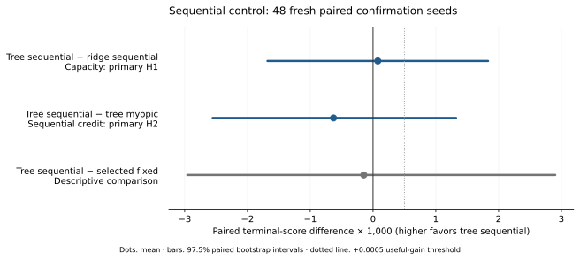

# Action Quality and Sequential Metacontrol in Verified Mathematical Search

Ayushi Chadha

Working manuscript, November 17, 2026. Completed numerical studies and limitations
are reported below. Submission formatting, packaging of earlier studies, and final
reference editing remain pending. The sequential study includes public raw evidence. No mathematical record improvement is claimed.

## Abstract

Adaptive decisions need not improve terminal performance. We study this distinction
in verified 26-circle packing under matched objective-evaluation budgets. Earlier
single-replacement experiments show a moderate revision configuration improving
over a broad alternative (+0.006012; adjusted 97.5% interval [0.003712, 0.008490]),
with a fresh doubled-budget replication; richer geometry does not establish
better timing. We then separate function-class capacity from sequential credit
using ridge and ExtraTrees critics, each trained on immediate rewards or backward
finite-horizon continuation values. All four controllers share observations,
local/moderate/restart options, and 640 objective calls per live rollout. With
96 training seeds, 16 validation seeds and 48 fresh paired confirmation seeds,
tree-sequential minus ridge-sequential is +0.000076 (97.5% interval
[-0.001681, 0.001832]); tree-sequential minus tree-myopic is -0.000630
([-0.002553, 0.001322]). Neither predeclared improvement test passes, and no
advantage over validation-selected always-moderate search is established.
The learned policies produce diverse action sequences, demonstrating a gap
between adaptive behavior and verified decision value. We release source-pinned
traces, fitted models and an offline audit. Findings are conditional on one
problem, one training set, compressed observations and a small action portfolio;
non-superiority does not imply equivalence or a general failure of metacontrol.

## 1. Research question and scope

The scientific question is whether observations of a running search process help
a controller select and revise search strategies beyond fixed schedules and
reactive rules. We test both one-time replacement and repeated option selection. This extends the adaptive-controller question of
our earlier hierarchical-reasoning work [12,13]. That work provides the conceptual
commitment/revision interface; the present worker is a numerical optimizer, not
an HRM model or a transfer of feudal latent goals.

The hypothesis is conditional: useful state-dependent control requires both
informative observations and useful alternative actions. A poor replacement can
make waiting a sensible policy; a good replacement can make an early fixed
switch sufficient. Neither pattern requires a learned adaptive controller.
Consequently, prediction error, action variability, and final decision value are
reported separately.

Our contributions are a frozen, verifiable commitment interface; matched timing
and observation comparisons with disjoint trajectory splits; and a predeclared
positive result for a moderate revision configuration alongside a negative result
for richer observation features. A separate sequential study controls model
capacity and credit assignment with shared data, actions and resource budgets,
and releases the full numerical evidence. We do not claim a new metareasoning principle,
a superior general controller, a record-breaking packing, or an autonomous
code-discovery system. The existing bounded parameter-autoresearch runner is
execution infrastructure, not the learned controller evaluated here.

## 2. Task, worker, and intervention contract

We use AlphaEvolve problem 36: maximize the sum of radii of 26 non-overlapping
circles contained in the unit square [8]. The source is pinned to commit
`8f447457957deac61e28bf1676746f0753b3b2f8`. The archived reference score
2.6359830849176076 is a reference construction, not an independently verified
current world record. Equal-radius packing tables concern a different objective.
Rounded table entries and tolerance-relaxed constructions cannot be used as
interchangeable record comparators [9–11].

The worker is SciPy SLSQP with analytic constraints and derivatives. Each episode
starts from a seeded repaired random arrangement and consumes eight windows of
80 objective evaluations: exactly 640 per policy. Each SLSQP call permits at most
40 iterations; a new call consumes any remaining window allowance if optimization
terminates early. Every call starts afresh, so there is no hidden optimizer history
across window boundaries. A conservative radius repair is checked by a separate
floating-point geometry verifier. The best verified incumbent is always retained.
The optimizer's loss is not accepted as proof of feasibility. Floating-point
checking does not constitute an exact rational certificate.

For the single-replacement studies, the initial commitment uses position perturbations with standard deviation 0.015.
KEEP retains the recipe. REVISE replaces it with a new perturbation scale that
persists thereafter. Each matched policy must replace the commitment once before
one of windows 1 through 7 (zero-based); no change is allowed before consuming
window 0 or after the terminal window. All matched policies have two emissions.
Never-revise is reported separately because it has only the initial emission.

A common never-revise rollout provides cloned incumbent, score, commitment,
window and evaluation-counter checkpoints. Random draws are keyed by seed,
window and within-window call index. Corresponding calls therefore share
standardized noise without outcome-dependent random-stream selection. Different
recipes can cause different solver paths and call counts; identical noise keys
do not imply identical solver trajectories.

A complete single-recipe timing landscape has seven replacement schedules plus
never-revise. Shared-prefix collection executes 2,880 objective evaluations per
seed. The two-recipe follow-up has fourteen schedules plus one shared baseline
and executes 5,120 evaluations per seed. Shared work is included in each policy's
logical 640-evaluation budget; it is not free policy compute. Counts of objective
calls are a reproducible work proxy, not equality of constraints, derivatives,
FLOPs, or wall time. Geometry extraction, repair, controller overhead and branch
collection must be distinguished from this proxy.

## 3. Single-replacement prediction and causal policy evaluation

At boundary t, the terminal regression target is the score from revising now
minus the mean terminal score of all strictly later replacement times with the
same recipe. This is advantage over a uniform delayed-revision comparator, not
an optimal-stopping value function. Ridge regression predicts that target.
Policies revise at the first threshold crossing; otherwise they must revise
before window 7. A separate local-target control in the initial pilot predicts
immediate-window rather than terminal advantage.

The time-only model uses time indicators. The progress model adds current
incumbent score, latest and previous gains, trailing stagnation length, and
interactions with time. The geometry model additionally includes:

- radius coefficient of variation and minimum-to-mean radius;
- circle-pair near-contact fraction and contact-degree standard deviation;
- fraction of circles in near contact with a wall;
- maximum clearance on a fixed 9x9 interior grid and occupied area.

Contact gaps use a predeclared 1e-4 threshold. Geometry is permutation invariant
and computed only from the current verified incumbent after a consumed window.
Features cannot read future windows or branch outcomes. Standardization uses
training data only. The corresponding feature dimensions are 7, 39, and 95.

All model families use ridge penalties {0.1, 1, 10, 100}, thresholds
{0, 0.0005, 0.001}, and validation mean terminal score for selection. Fixed clocks
are selected from all seven timings; reactive rules use validation-selected
stagnation patience {1, 2, 3} with improvement tolerance 1e-7. Ties use the first
predeclared candidate. Policies are not refit after selection.

Confirmation uses causal replay of complete deterministic branches. The policy
examines consumed never-revise prefixes until its first replacement, then takes
that schedule's full terminal outcome. Because the worker and random streams are
fixed and no subsequent replacement is permitted, this selects the trajectory
the policy would execute. It is not a live-controller latency test. Outcomes
are evaluation targets, never inputs to the stopping decision. Seeds—not branch
rows—are the independent units for paired bootstrap intervals.

## 4. Initial audits and hypothesis formation

A twelve-seed development audit with broad replacement scale 0.12 found a
retrospective per-seed timing-oracle advantage of 0.002429 over its best mean fixed
timing. This optimistic ceiling established observed timing heterogeneity, not
state predictability. These seeds were subsequently training-only.

A first prediction pilot used 24 training, 12 validation, and 24 untouched
confirmation seeds. Progress-conditioned and time-only terminal policies both
revised before window 7 on all 24 confirmation seeds and scored 2.616691995 on
average. Their paired difference was zero. Prediction MSE was slightly lower
for progress conditioning, but sign accuracy was below the always-nonpositive
baseline. Neither its comparison with reactive control nor with a local-target
policy established an advantage. This pilot motivated the follow-up; its
confirmation seeds were never reused for selection or confirmation there.

The follow-up predeclared two hypotheses:

**H1: observations.** Adding geometry improves terminal policy value over progress
features with the original broad revision held fixed.

**H2: revision configuration.** A moderate recipe, with its validation-selected
fixed schedule, improves over the broad recipe's selected fixed schedule. The
moderate scale is the geometric midpoint sqrt(0.015 * 0.12) = 0.0424264, fixed
before collection rather than chosen from a sweep. H2 compares complete fixed
configurations and does not isolate strength at an identical switch time.
It also does not establish that an adaptive controller adds value.

All 84 follow-up seeds are fresh: 24 training, 12 validation, and 48 confirmation.
The larger confirmation sample improves precision but is not a formal power
guarantee. Policies and baselines freeze before confirmation collection. For
each primary contrast, success requires mean gain at least 0.0005 and a positive
lower endpoint of a paired 97.5% bootstrap interval (20,000 resamples). The
interval level uses a Bonferroni adjustment for two primary hypotheses. Secondary
comparisons are exploratory. The source-hashed protocol was committed as
`876717a` before collection; no outcome-dependent changes were made.

## 5. Confirmation results

All 84 seed collections completed and passed local geometry and trace-accounting
revalidation: 1,260 distinct schedule trajectories, including 720 in confirmation.
The duplicate serialized never-revise row across recipe families is counted once.

| Predeclared primary contrast | Mean paired gain | Adjusted 97.5% interval | Gate |
|---|---:|---|---|
| H1: geometry-broad minus progress-broad | 0.000281255 | [-0.000208784, 0.001007672] | Failed |
| H2: fixed-moderate minus fixed-broad | 0.006011583 | [0.003712203, 0.008490446] | Passed |

H1 had three wins, two losses and 43 ties in terminal score. Different timing
choices often retained the same incumbent. H2 had 36 wins, seven losses and five
ties. The fixed moderate policy switches before window 4; the fixed broad policy
switches before window 5. Both choices were selected on validation data.
The positive result therefore concerns the selection procedure's two fixed
configurations, not a learned adaptive decision or a pure same-clock effect.

| Frozen policy | Broad recipe mean | Moderate recipe mean |
|---|---:|---:|
| Time-only | 2.617156225 | 2.626121931 |
| Progress-conditioned | 2.616899924 | 2.626121931 |
| Geometry-conditioned | 2.617181179 | 2.625974326 |
| Validation-selected fixed | 2.618358471 | 2.624370054 |
| Validation-selected reactive | 2.617696655 | 2.625064616 |
| Retrospective timing oracle | 2.621320568 | 2.629660981 |

Never-revise scored 2.617123205. Oracle scores use confirmation outcomes and are
not deployable policies. The highest individual confirmation construction scored
2.634292399, below the archived reference; no new bound is claimed.

Geometry-moderate minus progress-moderate averaged -0.000147605, with interval
[-0.000833543, 0.000460980]. Geometry-moderate minus fixed-moderate averaged
0.001604272, with interval [-0.001012204, 0.004133562]. Geometry-broad minus
time-broad averaged 0.000024954, with interval [-0.000685179, 0.000841260]. These
secondary comparisons do not establish an adaptive geometry-policy advantage.

The moderate time-only and progress policies both switch at window 1 on every
confirmation seed. Their higher mean than the validation-selected fixed window 4
is therefore not evidence for adaptation: they are alternative clocks. This also
illustrates uncertainty in schedule selection from twelve validation seeds.

For broad revision, geometry MSE (3.36217e-5) is slightly lower than progress MSE
(3.45088e-5) but higher than time-only MSE (3.33145e-5). Geometry sign accuracy is
65.28%, compared with 80.90% for the always-nonpositive baseline. Prediction
improvements relative to one comparator do not establish useful decisions.

### Descriptive same-clock sensitivity check

After the primary analysis, we inspected every clock rather than selecting one
favorable timing. Moderate mean scores exceeded broad means at all seven clocks:

| Revision before window | Broad mean | Moderate mean |
|---|---:|---:|
| 1 | 2.614637223 | 2.626121931 |
| 2 | 2.616159093 | 2.625006927 |
| 3 | 2.616862318 | 2.624416474 |
| 4 | 2.617740322 | 2.624370054 |
| 5 | 2.618358471 | 2.623020515 |
| 6 | 2.617417265 | 2.621032510 |
| 7 | 2.617156225 | 2.620042382 |

This post-hoc descriptive check is consistent with a recipe-quality effect, but
is not a new predeclared confirmatory endpoint or proof of a particular disruption
mechanism. Confirmation data will not be reused to tune a new recipe or controller.

### Predeclared doubled-budget replication

A subsequent single-hypothesis replication doubled the objective budget from
640 to 1,280 evaluations (160 per window), preserving the two recipes and their
previously selected schedules: moderate before window 4, broad before window 5.
No schedules or models were reselected. Forty-eight fresh paired seeds
2026230000–2026230047 were allocated before execution. Success retained the
minimum mean gain of 0.0005 and a positive 97.5% paired bootstrap lower bound;
this interval is conservative for the single replication hypothesis.

Moderate averaged 2.627881209 versus broad 2.620085056. The mean paired gain was
0.007796153, with interval [0.005102243, 0.010784626]: 38 wins, two losses and
eight ties. The declared gate passed. All 96 saved constructions passed independent
geometry, score and exact-budget revalidation. The 124-test suite passed.

This supports the fixed-configuration advantage at a second budget. It does not
prove an interaction with budget or that the advantage increased: the budgets
used different seed cohorts, and no cross-budget interaction test was specified.
The schedules differ between recipes, so this remains a configuration comparison,
not a pure same-time strength intervention or learned adaptive-controller result.
The same problem and optimizer were retained; cross-problem robustness remains open.

The manifest was saved before calls in `outputs/budget-replication-v1/`; unlike
the preceding study, this compact runner was not committed before collection.
It refuses an existing output directory and leaves interrupted batch markers;
it has no automatic retry/resume mechanism. Collections ran on Modal CPU in batches
of four with 600-second per-seed limits. The small paired bootstrap was computed
locally from saved outcomes, not as a new optimization run. Workspace billing
subsequently displayed $0.18 total, credit-offset with $0 billed (rounded and
potentially delayed), versus the previous displayed $0.17. App:
`ap-it57xwYJQ7gSiRDKGI5c8H`. Script: `scripts/modal_budget_replication.py`.

### Sequential-control follow-up: frozen protocol

The earlier experiments evaluate a single irreversible replacement. We now
specify a separate finite-horizon decision problem with repeated choices among
local perturbation (sigma=0.015), moderate perturbation
(sigma=sqrt(0.015*0.12)), and restart (uniform centers in [0.05,0.95], initial
radii 0.01). Each option receives exactly 80 objective evaluations, with eight
windows per rollout. Each returned candidate is independently checked; the
incumbent changes only on feasible improvement. Repeated switches are allowed,
counted, and do not carry an invented reward penalty. Computation and controller
wall time are reported separately from the matched objective budget. All arms
extract observations for common audit logging, including fixed policies that
do not require them for their decisions.

We compare ridge and ExtraTrees critics, each with myopic and sequential credit.
For each window t and option a, finite-horizon fitted Q iteration [14] regresses
`1000*(score_next-score) + max_b Q_(t+1)(observation_next,b)`; the final-window
bootstrap is zero. Myopic critics omit the continuation term. Gamma=1 makes
accumulated unscaled improvement telescope to terminal minus initial score.
Critics receive 16 consumed-state features: remaining budget, score, two recent
gains, stagnation, option age, previous-option indicators, and seven geometry
features. They cannot read future states. These compressed features need not be
Markov; this is approximate finite-horizon control, not a convergence guarantee.

Ridge standardizes training features, uses an unpenalized intercept and alpha=10.
ExtraTrees uses 64 trees, maximum depth 5, minimum leaf size 8, random seed 731,
and a single CPU thread. Separate window/action heads avoid imposing a common
action slope. All settings are fixed; no hyperparameter sweep is conducted.
We export numerical model arrays to JSON and log observations, action values,
choices and independently verified constructions on every evaluation window.

Training uses 96 fresh seeds (2026240000–2026240095). At each visited state all
three actions branch from the same incumbent; a seeded uniform behavior policy
selects which branch continues. This yields 2,304 transitions from 96 paths,
with shared noise keys within a window. Coverage of all immediate actions does
not guarantee support for future learned-policy states. Sixteen separate seeds
(2026250000–2026250015) select a static comparator from always-local,
always-moderate and local-to-moderate/window-4. Four learned policies are fixed
from training; validation does not tune their hyperparameters. A two-stagnant-
window reactive rule is also retained. Forty-eight untouched paired seeds
(2026260000–2026260047) then execute full live rollouts, with 640 objective calls
per policy; old single-switch counterfactual replay is not used.

The two primary hypotheses are H1: tree-sequential exceeds ridge-sequential
(model capacity), and H2: tree-sequential exceeds tree-myopic (sequential credit).
Each requires mean score gain >=0.0005 and a positive lower endpoint of a 97.5%
paired seed bootstrap interval (20,000 resamples, Bonferroni adjustment for two
primary contrasts). Ridge-myopic and the gap to the validation-selected static
policy are descriptive controls. No automatic policy promotion follows a result.
Learning a superior controller would additionally require evidence against a
strong fixed comparator and replication; primary contrast support alone is
insufficient. Intervals condition on the single fitted training set and selected
comparator; they do not quantify variability across repeated training datasets. Collection, fitting and substantive analysis run on Modal CPU.
The frozen protocol caps function execution at $1.725936 plus $0.50 overhead
reserve, within the cumulative $10 allowance. Results follow below.

A pre-fitting portability amendment replaces bitwise equality of recomputed
observations/rewards/trace scores with absolute tolerance 1e-12 (zero relative
tolerance). macOS and Linux reconstruction of one initial score differed by
7e-16. Independent feasibility remains strict, and evaluation counts/actions
remain exact. Original training artifacts and their original manifest identity
are retained; no data are recollected, and no model, action, split, hypothesis
or selection rule changes. The amendment occurs before model fitting or any
validation/confirmation dispatch. It is a software portability correction,
not an outcome-driven protocol change.

### Sequential confirmation results

All 48 confirmation seeds completed. Validation selected always-moderate search
(mean 2.627966654) over fixed/window-4 (2.627812361) and always-local
(2.620899955). This selection preceded confirmation and was not changed afterward.
Every confirmation policy used exactly 640 objective calls.

| Policy | Mean terminal score | Mean switches | Mean episode seconds |
|---|---:|---:|---:|
| Always moderate (selected fixed) | 2.624710591 | 0.00 | 4.223 |
| Reactive | 2.621470007 | 1.94 | 4.981 |
| Ridge, myopic | 2.625304450 | 4.17 | 4.349 |
| ExtraTrees, myopic | 2.625193527 | 3.35 | 4.513 |
| Ridge, sequential | 2.624487974 | 5.21 | 4.138 |
| ExtraTrees, sequential | 2.624563888 | 3.79 | 4.442 |

| Contrast | Mean difference | Paired 97.5% interval | Status |
|---|---:|---|---|
| Sequential H1: tree minus ridge | +0.000075914 | [-0.001680902, +0.001831500] | Improvement not established |
| Sequential H2: sequential minus myopic, tree | -0.000629639 | [-0.002553465, +0.001322107] | Improvement not established |
| Tree-sequential minus selected fixed | -0.000146703 | [-0.002958453, +0.002902246] | Descriptive |

Neither primary hypothesis meets its predeclared improvement criterion. H1 has
22 wins, 20 losses and 6 ties; H2 has 12 wins, 20 losses and 16 ties. These
intervals include improvements above the minimum useful gain as well as losses:
the result is failure to establish superiority, not evidence of equivalence or
proof that sequential credit cannot help. Ridge-myopic has the highest observed
mean, but no confirmatory superiority claim was predeclared for that ranking.



Figure 1. Points show paired mean differences; bars are 97.5% seed bootstrap
intervals. The first two contrasts are primary; the fixed-comparator gap is
descriptive. The dotted line marks the +0.0005 practical-gain threshold.

The controllers are behaviorally adaptive. Ridge-myopic, ridge-sequential,
tree-myopic and tree-sequential produced 36, 31, 23 and 31 distinct action
sequences, respectively, across 48 seeds. Tree-sequential selected local,
moderate and restart options 117, 238 and 29 times across 384 windows. Its
myopic counterpart selected them 93, 277 and 14 times. Ridge-sequential used
86 restarts versus 45 for ridge-myopic. More varied choices and more restarts
do not establish useful planning. A continuation-value calibration/support audit
is a motivated next question; these counts do not diagnose its outcome.

Mean controller-plus-observation time per episode was 0.00471 seconds for
ridge-sequential and 0.06186 seconds for tree-sequential, versus 0.00378 seconds
for the fixed policy. These measurements include Python/JSON-array inference;
they are not an optimized inference benchmark. Overall episode time also differs
because equal objective counts do not equalize optimizer internals. No learned
policy is promoted on these results.

The best observed confirmation construction scores 2.635983082281558
(tree-sequential, seed 2026260015), below the archived reference
2.6359830849176076. This selected maximum neither beats that reference nor
establishes policy superiority, and it is not a verified current-world-record claim.

## 6. Interpretation, limits, and next decision

The positive evidence remains an improvement in an available revision configuration,
replicated under two search budgets. The subsequent sequential experiment makes
the control problem richer and tests a nonlinear function class, but establishes
neither a capacity advantage nor a benefit from continuation-value targets.
Behaviorally adaptive choices alone are insufficient evidence for an effective
research controller. None of the sequential findings justifies automatic promotion
of a learned policy over the selected fixed baseline.

The sequential study uses one circle count, one optimizer, one 640-call regime,
96 training paths and a single fit per method. The three actions may provide
limited state-dependent opportunity. Compressed features can alias distinct
constructions; random-behavior training paths may not cover learned-policy states;
maximization over approximate continuation values can introduce estimation bias.
These are plausible limitations, not established explanations of the results.
Confidence intervals remain wide relative to the practical-gain threshold and
condition on the fitted models. We have not measured repeat-training variability,
proved the observations Markov, or established cross-problem transfer.

We stop this study at its declared comparisons. A targeted next study should
first audit whether continuation-value estimates predict action differences on
fresh cloned states, distinguishing insufficient action opportunity from value
estimation and support errors. That would require a new protocol and fresh data;
we do not run additional searches or tune on this confirmation set. A larger
neural network or LLM controller is not justified merely by the present null result.
Runtime policy-promotion gates, calibrated fallback and new benchmark adapters
remain separate work. A floating-point feasibility check does not certify policy
improvement or safe recursive self-improvement.

## 7. Relation to prior work and the HRM project

Russell and Wefald [1] and Hay et al. [2] ground computational choices in terminal
decision utility. Honda et al. [3] show the importance of environment/planner
context and reactive replanning baselines; Xu et al. [4] train continuation
policies using trajectory outcomes. Our earlier ridge stopping experiment is not a
reproduction of their reinforcement-learning methods and does not establish a
new theoretical metareasoning result.

The sequential follow-up is a form of dynamic algorithm configuration [15,16]:
state-conditioned choices alter a numerical worker during execution. We use
finite-horizon fitted Q regression with ridge or randomized-tree approximators,
building on tree-based batch reinforcement learning [14]. These are established
method families; our contribution is the controlled separation of representation,
sequential credit and action quality in this verified search environment. An
action portfolio and runtime logs do not themselves establish autonomous
scientific discovery, a novel RL algorithm or safe recursive self-improvement.
The fixed verifier checks candidate feasibility, not the superiority of a policy.

HRM [5] and FeUdal Networks [6] motivate the earlier latent commitment interface.
Our first paper studies persistence; the second distinguishes state-dependent
scores, policies and useful revision [12,13]. The present mathematical worker
is an explicit extension of that question, not demonstrated transfer of HRM or
feudal alignment. Karpathy's autoresearch [7] motivates fixed evaluation,
bounded experiments and retained decisions. Our restricted parameter proposer
is infrastructure; these experiments do not implement autonomous source-code
invention or establish a record-beating research agent.

The saved HRM audits explain why a more inspectable worker was useful. In 64
original episodes, recorded loss preferred persistence at 347 of 384 states, but
neither action solved an example. A source-separated development audit of 80
problems likewise had no exact solves under either branch. In a 1,600-update,
four-example memorization control, all 396 scored predictions copied the input;
96.72% token accuracy matched the identity baseline and changed-token accuracy
was 0/13. Matched targets came from unique dataset rows within puzzle ID 9872.
This is a behavioral diagnosis of those artifacts, not a universal failure of
HRM or proof of an architectural bug. Mathematical results do not resolve missing
HRM competence, exact-count, or multiseed architectural evidence.

SQLite and earlier neural packing demonstrations remain supporting engineering
records. They are not pooled with the current study or used as independent
confirmation. The initial numerical neural study did not establish superiority
over always-local search.

## 8. Reproducibility and resource accounting

Core code: `scripts/matched_revision.py`, `scripts/predict_revision.py`, and
`scripts/revision_hypotheses.py`, with corresponding Modal runners. The worker
image pins NumPy 2.2.6 and SciPy 1.15.3 on Python 3.11. Manifests pin source hashes,
seed partitions and rules. Pending-call markers prevent silent paid retries;
changed source identities invalidate resumption. Output validation replays geometry,
intervention count, timing and budget checks. All 134 tests passed, including ten new checks of repeated switching, delayed
credit, model export equivalence, leakage, geometry, budgets and failed dispatch.
Three macOS BLAS warnings occurred inside the sklearn reference ridge calculation;
its finite outputs matched our exported model to 1e-12. Production ridge uses an
equivalent centered solve with einsum. Tests do not replace experimental evidence.

The first timing audit ran twelve development seeds; the prediction pilot ran
48 new collections plus two analyses. The follow-up ran 84 collections and two
analyses, up to four CPU collections concurrently, without retries or a payment
method. It used 2,763.05 aggregate collection CPU-seconds. A rate-based collection
estimate is $0.0485, excluding analysis/setup/idle. Workspace billing displayed
$0.10 before and $0.17 afterward, fully offset by credits and $0 billed. These
rounded totals can lag or reconcile; they are not exact per-run invoices. The
study stayed within the authorized $10 allowance.

Follow-up app: `ap-tRiwWPhOlw520FyvrXHGW6`.
Raw constructions, traces, models and execution receipt are retained locally in
`outputs/revision-hypotheses-v1/` and remain ignored by Git. Public raw-artifact
packaging is pending; hashes alone do not replace access to those artifacts.

- Manifest SHA-256: `ff4be1a74bd00db5586d2efc3f3b0061f93b86e388da079fe9cec1fe9e7f5161`
- Frozen policies: `75fdd36b01b1e94f6bddf4c9fab6601708e211afe071dbdcf91db39adfac3a92`
- Confirmation summary: `ec1c45571132352a8657966c03aeeb17f194a28ae3a8d0a77d0b36fba5a5f42b`

Earlier run artifacts remain in `outputs/matched-revision-v1/` and
`outputs/revision-prediction-v2/`. The latter's protocol commit is `9a099c6`;
its confirmation summary hash is
`566b5ed98258c473cb0b98121a40c00f7ca63c2db0f7f86579c97f0cebcf3bde`.
Saved HRM evidence can be inspected with `scripts/audit_manuscript_evidence.py`
and `scripts/diagnose_hrm_copy_baseline.py`; these do not replicate training.

### Sequential evidence release and cost

The sequential source is `scripts/sequential_controller.py`; the bounded runner
is `scripts/modal_sequential_controller.py`. The image additionally pins
scikit-learn 1.8.0. Protocol commit `d3bc409` precedes collection; audit-only
amendment `4ef0cea` precedes fitting. Collection app `ap-RydummZelRd26J73EfHubJ`
completed all 96 training paths before a local exact-equality audit stopped the
run. Continuation app `ap-hf25YyN9JrdQ6fPUnbDWMq` reused those unchanged records,
then fitted, selected the fixed comparator, and evaluated confirmation. No paid
collection was retried. There were 163 unique function calls, 2,304 training
transitions and 336 evaluation rollouts (48 validation and 288 confirmation),
using 399,360 objective evaluations in total.

The offline audit rechecked original-to-amended provenance, all constructions,
causal observations, exact evaluation budgets, logged decisions, frozen-model
predictions and the result summary. Maximum prediction discrepancy was
4.55e-13 in milli-score units. The audit performs no fitting or cloud calls.
Recorded function time totals 2640.21 seconds,
corresponding to approximately $0.0463 at
[Modal's published CPU/memory rates](https://modal.com/pricing), excluding
build/startup/idle/egress. This is an estimate, not a refreshed invoice. The last
observed prior workspace total was $0.18, credit-covered; browser access was not
available to refresh billing. The conservative execution cap plus overhead
reserve remained far below the authorized $10 total.

A single [evidence archive](artifacts/sequential-controller-evidence.tar.gz)
contains all original/amended JSON records, models, manifests, freeze/import
receipts and the audit receipt (264 files, 7.19 MB compressed). Earlier studies'
raw artifacts remain separately pending public release. Current sequential hashes:

- Amended manifest: `a292337aae2c589f1b0e647fc91d259758fbab10b7b4b52f018c9b81b6e865ed`
- Fitted model artifact: `084015b652a64b83b9d01c2482de92d26472432bd81db97779164b5d7c5e91c2`
- Confirmation summary: `da0d3a86076e0c24c3f0af7a6d045b32e27b76003eeba1fce78ea7485beda668`
- Evidence archive: `9e78f5eaab1263fd1b070b830fd43cc5d73f0a8e2b6069f6e49310f1ce82e124`

From a fresh checkout with NumPy/SciPy/scikit-learn available, extract and audit:

```bash
tar -xzf papers/trust4rsi/artifacts/sequential-controller-evidence.tar.gz
python -m scripts.audit_sequential_controller --output outputs/sequential-controller-v2
python -m scripts.plot_sequential_controller
```

The first two commands inspect saved evidence without Modal. The last command
regenerates Figure 1 and additionally requires Matplotlib. Timing metadata is
observed on the original cloud run, not recreated by the offline audit.

## 9. Conclusion

Moderate replacement improved a fixed search configuration and retained its
advantage at a second budget. Geometry-conditioned timing and the later
ridge/tree sequential comparison did not establish useful adaptive gains under
their declared tests. The latter produced diverse actions without a demonstrated
improvement in terminal value. A credible metacontrol evaluation must separate
better available actions, richer prediction functions, sequential credit and
actual policy benefit, with the final decision grounded in independent evidence.

## References

Primary sources checked November 16–17, 2026. Exa retrieved full text for Honda,
Xu, and Hay, and the publisher abstract for Russell and Wefald. Targeted methods
inspection informed the comparison below; none of these algorithms has been
reproduced in this study. Cached extraction does not establish a live leaderboard
snapshot. Audit requests and responses are retained locally under outputs/exa-audit/.

1. Russell, S., and Wefald, E. (1991). Principles of metareasoning.
   Artificial Intelligence 49(1–3), 361–395.
   https://doi.org/10.1016/0004-3702(91)90015-C
2. Hay, N., Russell, S., Tolpin, D., and Shimony, S. E. (2012).
   Selecting Computations: Theory and Applications. UAI 2012.
   https://arxiv.org/abs/1207.5879
3. Honda, K., Yonetani, R., Nishimura, M., and Kozuno, T. (2023; revised 2024).
   When to Replan? An Adaptive Replanning Strategy for Autonomous Navigation
   using Deep Reinforcement Learning. https://arxiv.org/abs/2304.12046
4. Xu, W., et al. (2026). Continue or Replan? Bernoulli-Continuation Policy
   Learning for Adaptive Horizon Execution. https://arxiv.org/abs/2608.03483
5. Hierarchical Reasoning Model (2025). https://arxiv.org/abs/2506.21734
6. FeUdal Networks for Hierarchical Reinforcement Learning (2017).
   https://arxiv.org/abs/1703.01161
7. Karpathy, A. (2026). autoresearch, README and program.md.
   https://github.com/karpathy/autoresearch
8. Georgiev, B., Gómez-Serrano, J., Tao, T., and Wagner, A. Z. (2025).
   Mathematical exploration and discovery at scale.
   https://arxiv.org/abs/2511.02864
   Problem 36: https://google-deepmind.github.io/alphaevolve_repository_of_problems/problems/36.html

9. OpenEvolve issue 156, original author report (2025).
   https://github.com/algorithmicsuperintelligence/openevolve/issues/156
10. Friedman, E. Circles in Squares: maximum sum of radii table.
    https://erich-friedman.github.io/packing/cirRsqu/
11. Göther Labs. Exact 26-circle unit-square packing, release v1.2.1.
    https://www.gotherlabs.com/results/circle-packing-26-unit-square/

12. Chadha, A. (2026). When to Re-Plan: Subgoal Persistence in Hierarchical
    Latent Reasoning. https://arxiv.org/abs/2606.03741
13. Chadha, A. (2026). A Score Is Not a Policy: Measuring the Value of Adaptive
    Revision. https://arxiv.org/abs/2609.00874

14. Ernst, D., Geurts, P., and Wehenkel, L. (2005). Tree-Based Batch Mode
    Reinforcement Learning. JMLR 6(18), 503–556.
    https://jmlr.org/papers/v6/ernst05a.html

15. Adriaensen, S., Biedenkapp, A., Shala, G., Awad, N., Eimer, T.,
    Lindauer, M., and Hutter, F. (2022). Automated Dynamic Algorithm
    Configuration. https://arxiv.org/abs/2205.13881
16. Eimer, T., Biedenkapp, A., Reimer, M., Adriaensen, S., Hutter, F., and
    Lindauer, M. (2021). DACBench: A Benchmark Library for Dynamic Algorithm
    Configuration. IJCAI 2021. https://arxiv.org/abs/2105.08541
